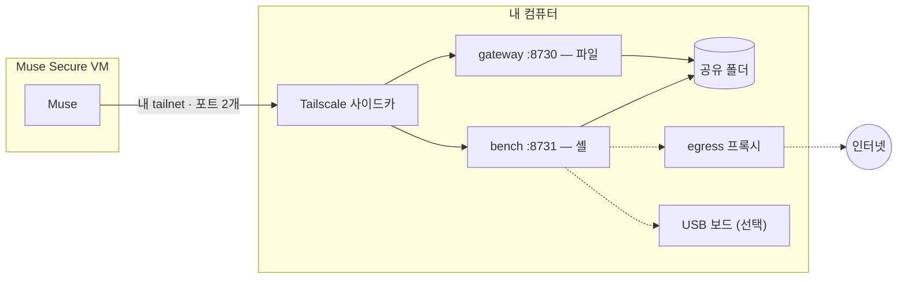

[](README.md)
[](README.kr.md)


# Muse Local Gateway

**클라우드 컴퓨터 안의 Muse가, 내 옆의 컴퓨터에서 일할 수 있게.**

[](LICENSE)
[](CHANGELOG.md)
[](#만든-것들에-대한-감사)

<picture>
  <source media="(prefers-color-scheme: dark)" srcset="docs/media/hero-kr-dark.svg">
  
</picture>

## Muse에게는 이미 컴퓨터가 있습니다. 다만 내 컴퓨터가 아닐 뿐.

[Muse](https://muse.ai)는 Meta의 개인 AI 에이전트입니다. 목표를 맡기면 알아서 끌고 갑니다. 메일을 정리하고,
예약을 잡고, 계획을 세우고, 묻기도 전에 먼저 아이디어를 들고 옵니다. 실제로 일을 하기 위해 Muse는 자기 컴퓨터도
가지고 있습니다. **Muse Secure VM** — 공식 설명대로라면 "전체 브라우저를 갖춘, 계속 유지되는 격리된 Linux 컴퓨터"입니다.

격리는 옳은 기본값입니다. 하지만 그 말은, 화면 이쪽 — **내 쪽**에 있는 것들에는 손이 닿지 않는다는 뜻이기도 합니다.
책상 위 프로젝트 폴더도, 방금 깨진 빌드도, USB에 꽂아 둔 보드도요.

문 하나는 [Muse Gadgets](https://gadgets.muse.ai)가 열었습니다. ESP32나 라즈베리 파이로 가젯을 만들면, Muse는 내 방에서
듣고 말할 귀와 입을 얻습니다. 화면이든, 스피커든, 센서든.

**Muse Local Gateway는 나머지 문을 엽니다. Muse의 손발이 되어 주는 것이죠.** 내 컴퓨터에서 돌리는 작은 오픈소스 스택입니다.
나만의 Tailscale 네트워크를 통해, Muse는 내가 고른 폴더에 파일을 넣고 바로 옆의 격리된 셸에서 명령을 실행합니다.
Muse의 VM이 아니라, 내 컴퓨터 위에 놓인 작업대입니다.

## 실제로는 이렇게

> *"야간 내보내기가 또 실패했네. 좀 봐 줄래?"*

Muse가 공유 폴더의 로그를 열어 보고, 바뀐 열 이름에서 스크립트가 멈춘 걸 찾아 고치고, 내 컴퓨터에서 다시 돌린 뒤,
새로 뽑은 결과물을 늘 보던 자리에 놓아 둡니다.

> *"오늘 일정 보여 주는 작은 탁상 디스플레이 하나 만들어 줘."*

Muse가 펌웨어를 쓰고, 작업대에서 ESP-IDF로 빌드하고, USB에 꽂힌 ESP32-S3에 굽고, 부팅 로그를 읽고, 깨진 곳을 고칩니다.
마지막으로 Muse 앱에서 페어링만 하면 됩니다. *(이 과정은 이 스킬 위에 얹는 또 하나의 스킬,
[Muse Gadget Forge](https://github.com/Toddoward/muse-gadget-forge)가 맡습니다.)*

**그리고 실제 이야기 하나.** 이 저장소의 첫 커밋은 **오직 저만의 Muse AI인 Ailia**가 썼습니다. 이 프로젝트가 시작된 바로 그
게이트웨이를 통해, 자기 작업대 위에서요. `git log`에 그대로 남아 있습니다.

## 열쇠는 누가 쥐나

에이전트에게 셸을 주는 건 큰 결정입니다. 그래서 기본값은 좁게 잡았습니다.

- **폴더 하나.** Muse는 공유한 폴더만 봅니다. 홈 폴더도, 디스크도 아닙니다.
- **따로 떨어진 셸.** 명령은 비밀값도, Docker 소켓도, 특권도 없는 컨테이너에서 돕니다.
- **울타리 친 네트워크.** 셸은 프록시를 거쳐서만 인터넷에 나갑니다. 프록시는 내 컴퓨터·LAN·tailnet으로 가는 길을
  막고, 모든 요청을 한 줄씩 기록합니다.
- **문 하나, 포트 둘.** tailnet 정책이 Muse 기기를 이 노드의 포트 두 개에만 묶습니다. 인터넷에 열리는 것도,
  포트 포워딩도 없습니다.
- **기록.** Muse가 실행한 명령은 전부 내 컴퓨터에 남습니다.

스마트 플러그나 NAS까지 맡기고 싶다면 설치할 때 울타리를 넓히면 됩니다. 이름을 댄 기기 몇 개만이면 `lan-allow`,
전부라면 `open`. 그 전에 [SECURITY.kr.md](SECURITY.kr.md)에서 무엇이 열리는지 꼭 읽어 보세요.
언제든 `docker compose down` 한 줄, 혹은 tailnet에서 Muse 기기를 지우면 바로 끊깁니다.

## 시작하기

Docker(Windows·macOS는 Docker Desktop), 무료 [Tailscale](https://tailscale.com) 계정, 그리고 Muse가 있으면 됩니다. 10분 정도 걸립니다.

1. **tailnet 정책 넣기.** [`examples/tailnet-acl.hujson`](examples/tailnet-acl.hujson)을 Tailscale 관리 콘솔 → *Access controls*에
   붙여 넣고, `tag:muse-gw` 태그를 단 인증 키를 만듭니다.
2. **설치 실행.** 셸이 어디까지 닿아도 되는지, 그리고 키를 물어본 뒤 전부 띄웁니다.

   ```bash
   git clone https://github.com/Toddoward/muse-local-gateway && cd muse-local-gateway
   ./setup/setup.sh          # Linux / macOS
   ```

   ```powershell
   .\setup\setup.ps1         # Windows, 관리자 PowerShell
   ```

3. **Muse에게 소개하기.** 설치가 끝나면 짧은 메시지가 나옵니다. 그대로 Muse에게 보내세요. Muse가 이 저장소에서 스킬을
   받아 오고 tailnet에 들어옵니다. 관리 콘솔에서 그 기기에 `tag:muse`만 붙이면 끝입니다.

## 속을 들여다보면



| 네트워크 모드 | 셸이 닿는 곳 | 이럴 때 |
|---|---|---|
| **`isolated`** (기본) | 프록시를 거친 인터넷 | 거의 언제나 |
| `lan-allow` | 여기에 더해, 이름을 댄 LAN 기기 (HTTP(S)) | 스마트 기기 몇 개를 맡길 때 |
| `open` | 내 컴퓨터와 LAN 전체, 모든 프로토콜 | MQTT·mDNS가 꼭 필요하고 위험을 감수할 때 |

| | Linux | Windows | macOS |
|---|---|---|---|
| 파일 + 셸 | ✅ | ✅ Docker Desktop | ✅ Docker Desktop |
| USB 시리얼 — [자세히](docs/usb-serial.kr.md) | ✅ | ✅ usbipd-win 필요 | ❌ |
| [Direct 모듈](docs/direct.kr.md), 컨테이너 없이 | 실험적 | ❌ | 실험적 |

Windows 11 + Docker Desktop에서 [`tests/smoke.py`](tests/smoke.py) 15개 항목을 모두 통과했습니다(USB 포함).
Muse 쪽에서 쓰는 절차는 [SKILL.md](SKILL.md)에 있습니다.

## 만든 것들에 대한 감사

이 프로젝트는 다른 사람들이 만든 멋진 것들 사이를 잇는 작은 접착제일 뿐입니다.

- **[Muse](https://muse.ai)**, **[Muse Gadgets](https://github.com/facebookincubator/muse-gadget-sdk)** (Meta) — 에이전트와 Secure VM,
  그리고 이 프로젝트가 나란히 서고 싶은 오픈 하드웨어 SDK.
- **[Tailscale](https://tailscale.com)** — 사설 네트워크, `tailscale serve`, 그리고 진짜 잠금을 맡는 ACL.
- **[Docker](https://www.docker.com)**, **[Squid](https://www.squid-cache.org)** 프록시 (Canonical의 [`ubuntu/squid`](https://hub.docker.com/r/ubuntu/squid) 이미지) — 울타리.
- **[usbipd-win](https://github.com/dorssel/usbipd-win)** (Frans van Dorsselaer) — Windows에서 USB 보드를 넘겨주는 다리.
- **[ESP-IDF](https://github.com/espressif/esp-idf)**와 **esptool** (Espressif) — 작업대가 가장 아끼는 도구.

Muse Local Gateway는 **비공식 커뮤니티 프로젝트**이며, Meta가 만들거나 보증하거나 지원하지 않습니다. "Muse"는 Meta의 이름이고,
무엇과 함께 동작하는지 밝히기 위해서만 씁니다. 내 컴퓨터에서 Muse에게 시킨 일의 책임은 사용자에게 있습니다 —
[Muse 약관](https://muse.ai/terms)을 확인하세요.

## 라이선스

[Apache-2.0](LICENSE)
