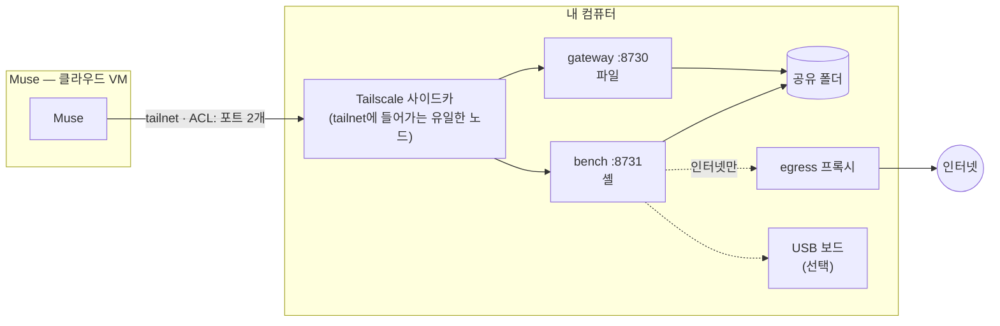

[](README.md)
[](README.kr.md)

# Muse Local Gateway

**Gadget이 Muse에게 클라우드 밖의 귀와 입을 주었다면,<br>
Local Gateway는 내 컴퓨터 곁에서 일할 손과 발을 줍니다.**

[](LICENSE)
[](CHANGELOG.md)
[](#자주-묻는-질문)

<!-- hero motion graphic: docs/media/hero.mp4 (제작 중) -->

Muse는 쉬지 않는 비서입니다. 할 일을 스스로 찾아 알려 주고, 직접 처리하고, 여러 일을 동시에 해냅니다.
하지만 그 모든 일은 닫힌 클라우드 VM 안에서만 일어납니다.
내 책상 위 빌드가 왜 깨졌는지 설명할 수는 있어도, 직접 고칠 수는 없습니다.

**Muse Local Gateway**는 내 컴퓨터에서 돌리는 작은 오픈소스 스택입니다. 나만의 Tailscale 네트워크로
Muse에게 두 가지를 줍니다.

- **손** — 내가 고른 폴더 하나에 파일을 넣고 꺼냅니다.
- **발** — 그 폴더 바로 옆의 격리된 셸에서 일합니다. 빌드, 스크립트, 데이터 작업, USB에 꽂힌 ESP32 굽기까지.

얼마나 멀리 닿을지는 사용자가 정합니다. 기본값은 폴더 하나, 프록시를 거친 인터넷, 그 외에는 없음입니다.

> 비공식 커뮤니티 프로젝트입니다. Muse 제작사와 관계가 없고 보증받지 않았습니다.

## 무엇이 달라지나

| | Muse만 있을 때 | Muse + Local Gateway |
|---|---|---|
| 내 파일 | 붙여 넣은 것만 봄 | 공유한 폴더를 읽고 씀 |
| 내 도구 | 명령어를 설명함 | 직접 실행하고, 결과를 읽고, 다시 시도함 |
| 내 하드웨어 | — | USB에 꽂힌 보드를 빌드·굽기·읽기 |
| 리마인드 | "야간 리포트가 실패했어요" | 다시 돌리고 "고쳤어요"라고 알려 줌 |
| 일하는 곳 | 자기 클라우드 VM | 내 컴퓨터, 내가 그은 울타리 안 |

## 열쇠는 사용자가 쥡니다

잠금장치 다섯 개가 기본으로 켜져 있습니다.

1. **폴더 하나.** Muse는 공유한 폴더만 봅니다. 홈 폴더도, 디스크도 보지 못합니다.
2. **분리된 셸.** 명령은 별도 컨테이너에서 돕니다. 비밀값 없음, Docker 소켓 없음, 특권 권한 없음.
3. **격리된 네트워크.** 셸은 프록시를 거쳐서만 인터넷에 나갑니다. 프록시는 내 컴퓨터·LAN·tailnet을
   (이름이 아니라 실제 주소로 확인해) 거부하고, 모든 요청을 기록합니다.
4. **tailnet ACL.** Muse 기기는 노드 하나의 포트 두 개에만 닿습니다. 인터넷에 열리는 것은 없고, 포트 포워딩도 없습니다.
5. **기록.** Muse가 실행한 모든 명령이 내 컴퓨터에 남습니다.

스마트 플러그나 NAS까지 닿아야 하나요? 설치할 때 위험을 먼저 확인한 뒤 `lan-allow`나 `open`을 고르세요.
자세한 내용은 [SECURITY.kr.md](SECURITY.kr.md)에 있습니다.

## 빠른 시작 (약 10분)

Docker(Windows·macOS는 Docker Desktop), 무료 Tailscale 계정, Muse가 필요합니다.

**1. tailnet 정책과 키.** [`examples/tailnet-acl.hujson`](examples/tailnet-acl.hujson)을 Tailscale 관리 콘솔 →
Access controls에 붙여 넣고 저장한 뒤, 태그 `tag:muse-gw`를 단 인증 키를 만듭니다.

**2. 설치 실행** — 네트워크 모드와 키를 물어본 뒤 전부 띄웁니다.

```bash
git clone https://github.com/Toddoward/muse-local-gateway
cd muse-local-gateway
./setup/setup.sh            # Linux / macOS
```

```powershell
.\setup\setup.ps1           # Windows, 관리자 PowerShell
```

**3. Muse에게 넘기기.** 설치가 끝나면 메시지가 나옵니다. 그대로 Muse에게 보내세요. Muse가 tailnet에
들어오면 관리 콘솔에서 그 기기에 `tag:muse` 태그를 붙입니다. 끝입니다.

언제든 `docker compose down`으로 멈출 수 있습니다. tailnet에서 Muse 기기를 지우면 그 즉시 끊깁니다.

## Muse가 할 수 있게 되는 일

- **빌드와 테스트** — 저장소를 공유 폴더에 받아 테스트를 돌리고, 실패를 읽고, 고치고, 다시 돌립니다.
- **데이터 잡무** — 넣어 둔 파일을 변환·이름 변경·분류·요약하고, 결과를 폴더에 써 둡니다.
- **하드웨어** — [muse-gadget-forge](https://github.com/Toddoward/muse-gadget-forge)와 함께 ESP32를 빌드·굽기·읽기.
- **집 안 기기** — `lan-allow` 모드에서, 지정한 기기의 HTTP API를 부릅니다(Shelly, Tasmota, ESPHome).

## 동작 방식



| 네트워크 모드 | 셸이 닿는 곳 | 이럴 때 |
|---|---|---|
| **`isolated`** (기본) | 프록시를 거친 인터넷. 내 컴퓨터와 LAN은 거부 | 거의 항상 |
| `lan-allow` | 위 + 지정한 LAN 기기 (HTTP(S)만) | Muse가 스마트 기기 몇 개를 다뤄야 할 때 |
| `open` | 내 컴퓨터와 LAN 전체, 모든 프로토콜 | 이유가 분명하고(MQTT, mDNS 검색) 위험을 받아들일 때 |

## 지원 환경

| | Linux | Windows | macOS |
|---|---|---|---|
| 파일 + 셸 | ✅ | ✅ Docker Desktop | ✅ Docker Desktop |
| USB 시리얼 ([자세히](docs/usb-serial.kr.md)) | ✅ | ✅ usbipd-win 필요 | ❌ Docker Desktop 불가 |
| [Direct 모듈](docs/direct.kr.md) (컨테이너 없이) | 실험적 | ❌ | 실험적 |

2026-10-12 Windows 11 + Docker Desktop(Compose v5.5)에서 [스모크 테스트](tests/smoke.py) 15/15 통과(USB 시리얼 포함).

## 자주 묻는 질문

**공식 프로젝트인가요?** 아닙니다. Muse의 Tailscale 연결 기능 위에 만든 커뮤니티 스킬입니다.

**Muse가 내 컴퓨터 전체를 쓰게 되나요?** 실험적인 direct 모듈을 고르지 않는 한 아닙니다. 기본은 폴더 하나와,
인터넷만 되는 격리된 셸입니다.

**블루투스는요?** 컨테이너에서는 현실적으로 어렵습니다. 블루투스 가젯은
[Muse Gadget SDK](https://github.com/facebookincubator/muse-gadget-sdk)로 Muse 앱과 페어링하세요.

**Muse가 악성 웹페이지에 속으면요?** 위의 잠금장치가 바로 그때를 위한 것입니다. 모드별로 공격자가 할 수
있는 일과 없는 일은 [SECURITY.kr.md](SECURITY.kr.md)에 정리했습니다.

## Muse용 문서

Muse가 이 스킬을 쓰는 방법: [SKILL.md](SKILL.md)

## 라이선스

[Apache-2.0](LICENSE). "Muse"는 해당 소유자의 상표이며, 무엇과 함께 동작하는지 밝히는 용도로만 씁니다.
