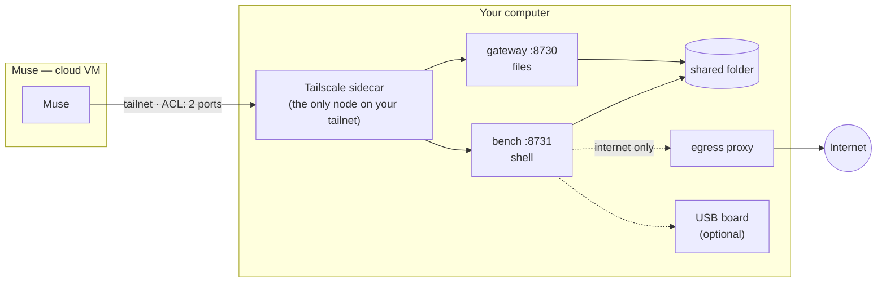

[](README.md)
[](README.kr.md)

# Muse Local Gateway

**Gadgets gave Muse ears and a voice outside the cloud.<br>
Local Gateway gives it hands and feet — on your own computer.**

[](LICENSE)
[](CHANGELOG.md)
[](#faq)

<!-- hero motion graphic: docs/media/hero.mp4 (in production) -->

Muse is an assistant that never clocks out. It looks for what needs doing on its own, reminds you,
and acts — several things at once. But all of that happens inside a sealed cloud VM.
It can tell you how to fix the build on your desk. It cannot fix it.

**Muse Local Gateway** is a small open-source stack you run on your own machine. Over your private
Tailscale network it gives Muse:

- **Hands** — files in and out of one folder you choose.
- **Feet** — a sandboxed shell right next to that folder: builds, scripts, data jobs, even flashing
  an ESP32 on your USB port.

You decide how far they reach. By default: one folder, the internet through a proxy, nothing else.

> Unofficial community project. Not affiliated with or endorsed by the makers of Muse.

## What changes

| | Muse alone | Muse + Local Gateway |
|---|---|---|
| Your files | Sees what you paste in | Reads and writes the folder you share |
| Your tools | Explains the command | Runs it, reads the result, tries again |
| Your hardware | — | Builds, flashes and reads boards on your USB port |
| Its reminders | "The nightly report failed" | Re-runs it and tells you it's fixed |
| Where it works | Its own cloud VM | Your machine, inside a fence you draw |

## You hold the keys

Five locks, all on by default:

1. **One folder.** Muse sees only the folder you share — not your home directory, not your disks.
2. **A separate shell.** Commands run in their own container: no secrets, no Docker socket, never privileged.
3. **An isolated network.** That shell reaches the internet only through a proxy that refuses your
   computer, your LAN, and your tailnet — checked against the resolved address. Every request is logged.
4. **A tailnet ACL.** Muse's device may reach exactly two ports on exactly one node. Nothing is
   exposed to the internet. No port forwarding.
5. **An audit trail.** Every command Muse runs is logged on your machine.

Need more reach — your smart plugs, your NAS? Choose `lan-allow` or `open` at install, with the
risks spelled out first. See [SECURITY.md](SECURITY.md).

## Quick start (about 10 minutes)

You need Docker (Docker Desktop on Windows/macOS), a free Tailscale account, and Muse.

**1. Tailnet policy and key.** Paste [`examples/tailnet-acl.hujson`](examples/tailnet-acl.hujson) into
Tailscale admin console → Access controls, save, then generate an auth key with the tag `tag:muse-gw`.

**2. Run setup** — it asks for the network mode and the key, then starts everything.

```bash
git clone https://github.com/Toddoward/muse-local-gateway
cd muse-local-gateway
./setup/setup.sh            # Linux / macOS
```

```powershell
.\setup\setup.ps1           # Windows, in an elevated PowerShell
```

**3. Hand it to Muse.** Setup prints a message — send it to Muse. When Muse joins your tailnet,
tag its device `tag:muse` in the admin console. That's it.

Stop anytime with `docker compose down`. Remove Muse's device from your tailnet and it is cut off at once.

## What Muse can do with it

- **Build and test** — clone a repo into the shared folder, run the tests, read the failure, fix, run again.
- **Data chores** — convert, rename, sort, summarize the files you drop in; write reports back.
- **Hardware** — build, flash and read ESP32 boards, with [muse-gadget-forge](https://github.com/Toddoward/muse-gadget-forge).
- **Home devices** — in `lan-allow` mode, call the HTTP APIs of devices you list (Shelly, Tasmota, ESPHome).

## How it works



| Network mode | The shell can reach | Pick it when |
|---|---|---|
| **`isolated`** (default) | The internet via the proxy. Your computer and LAN are refused | Almost always |
| `lan-allow` | Above + the LAN devices you list, over HTTP(S) | Muse should drive a few smart devices |
| `open` | Your computer and the whole LAN, every protocol | You know why (MQTT, mDNS discovery) and accept the risk |

## Platform support

| | Linux | Windows | macOS |
|---|---|---|---|
| Files + shell | ✅ | ✅ Docker Desktop | ✅ Docker Desktop |
| USB serial ([details](docs/usb-serial.md)) | ✅ | ✅ with usbipd-win | ❌ Docker Desktop can't |
| [Direct module](docs/direct.md) (no container) | experimental | ❌ | experimental |

Verified on Windows 11 + Docker Desktop (Compose v5.5), 2026-10-12: [smoke test](tests/smoke.py) 15/15, USB serial included.

## FAQ

**Is this official?** No. It is a community skill built on Muse's Tailscale connectivity.

**Does Muse get my whole computer?** Not unless you choose the experimental direct module. By default
it gets one folder and a sandboxed shell with internet only.

**Bluetooth?** Not from a container in any practical way. Pair Bluetooth gadgets with the Muse app
through the [Muse Gadget SDK](https://github.com/facebookincubator/muse-gadget-sdk) instead.

**What if Muse is tricked by a malicious web page?** That is exactly what the locks above are for.
Read [SECURITY.md](SECURITY.md) for what an attacker could and could not do in each mode.

## For Muse

How Muse uses this skill: [SKILL.md](SKILL.md).

## License

[Apache-2.0](LICENSE). "Muse" is a trademark of its owner, used here only to say what this works with.
