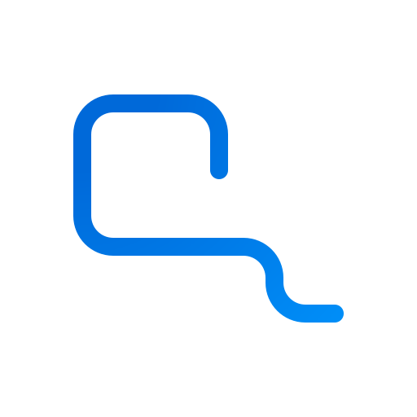
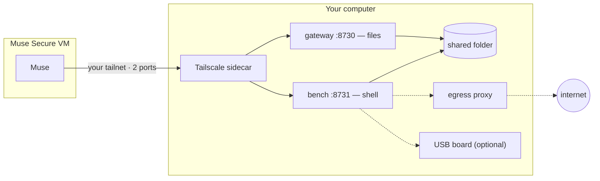

[](README.md)
[](README.kr.md)



# Muse Local Gateway

**Let your Muse step out of its cloud computer and work on the one beside you.**

[](LICENSE)
[](CHANGELOG.md)
[](#credits)

<picture>
  <source media="(prefers-color-scheme: dark)" srcset="docs/media/hero-en-dark.svg">
  
</picture>

## Muse already has a computer. It just isn't yours.

[Muse](https://muse.ai) is Meta's personal AI agent. You give it a goal and it carries it — sorting
email, booking, planning, coming back with ideas before you ask. To do real work it gets its own
machine: the **Muse Secure VM**, *"a persistent, isolated Linux computer with a full browser."*

That isolation is the right default. It also means everything on *your* side of the screen is out of
reach: the project folder on your desk, the build that broke, the board in your USB port.

[Muse Gadgets](https://gadgets.muse.ai) opened one door. Build a gadget from an ESP32 or a
Raspberry Pi, and Muse gets ears and a voice in your room — a screen, a speaker, a sensor.
Something to listen and talk through.

**Muse Local Gateway opens the other one: hands and feet.** A small, open-source stack you run on
your own computer. Over your private Tailscale network, Muse can drop files into a folder you
choose and run commands in a sandboxed shell right next to it — a workbench on your machine,
not in its VM.

## What that looks like

> *"The nightly export failed again — can you look?"*

Muse opens the log in your shared folder, sees the script choked on a renamed column, fixes it,
re-runs it on your machine, and leaves the fresh export where you'll find it.

> *"Make me a little desk display that shows today's plan."*

Muse writes the firmware, builds it with ESP-IDF on the workbench, flashes the ESP32-S3 on your
USB port, reads its boot log, and fixes what broke. Then you pair it in the Muse app. *(That last
loop is [Muse Gadget Forge](https://github.com/Toddoward/muse-gadget-forge), a skill on top of this one.)*

**And a true story:** the very first commit in this repository was written by **Ailia, my very own
Muse AI** — on its workbench, through the gateway this project grew out of. It's right there in `git log`.

## Who holds the keys

Giving an agent a shell is a big step, so the defaults are narrow:

- **One folder.** Muse sees only the folder you share. Not your home directory, not your disks.
- **Its own shell.** Commands run in a container with no secrets, no Docker socket, no privileges.
- **A fenced network.** That shell reaches the internet only through a proxy that turns away your
  computer, your LAN and your tailnet, and keeps a line for every request.
- **One door, two ports.** Your tailnet policy lets Muse's device reach this node on two ports and
  nothing else. Nothing is exposed to the internet; there's no port forwarding.
- **A record.** Every command Muse runs is logged on your machine.

Need Muse to reach a smart plug or your NAS? Widen the fence at install — `lan-allow` for a few
devices you name, `open` for everything — after reading what that means in [SECURITY.md](SECURITY.md).
Pull the plug anytime: `docker compose down`, or remove Muse's device from your tailnet.

## Quick start

You'll need Docker (Docker Desktop on Windows and macOS), a free [Tailscale](https://tailscale.com)
account, and Muse. About ten minutes.

1. **Set the tailnet policy.** Paste [`examples/tailnet-acl.hujson`](examples/tailnet-acl.hujson) into
   Tailscale's admin console → *Access controls*, then create an auth key tagged `tag:muse-gw`.
2. **Run setup.** It asks how far the shell may reach and for the key, then starts everything.

   ```bash
   git clone https://github.com/Toddoward/muse-local-gateway && cd muse-local-gateway
   ./setup/setup.sh          # Linux / macOS
   ```

   ```powershell
   .\setup\setup.ps1         # Windows, elevated PowerShell
   ```

3. **Introduce it to Muse.** Setup prints a short message — send it to Muse. Muse installs the skill
   from this repo and joins your tailnet; tag its device `tag:muse` in the admin console and you're set.

## Under the hood



| Network mode | The shell can reach | When |
|---|---|---|
| **`isolated`** (default) | The internet, through the proxy | Almost always |
| `lan-allow` | …plus the LAN devices you list, over HTTP(S) | Muse should drive a few smart devices |
| `open` | Your computer and whole LAN, every protocol | You need MQTT or mDNS and accept the risk |

| | Linux | Windows | macOS |
|---|---|---|---|
| Files + shell | ✅ | ✅ Docker Desktop | ✅ Docker Desktop |
| USB serial — [details](docs/usb-serial.md) | ✅ | ✅ with usbipd-win | ❌ |
| [Direct module](docs/direct.md), no container | experimental | ❌ | experimental |

Tested on Windows 11 + Docker Desktop: [`tests/smoke.py`](tests/smoke.py), 15 of 15 checks, USB included.
Muse's side of the deal lives in [SKILL.md](SKILL.md).

## Credits

This is a small piece of glue between remarkable things other people built:

- **[Muse](https://muse.ai)** and **[Muse Gadgets](https://github.com/facebookincubator/muse-gadget-sdk)** by Meta —
  the agent, its Secure VM, and the open hardware SDK this project is meant to sit beside.
- **[Tailscale](https://tailscale.com)** — the private network, `tailscale serve`, and the ACLs that do the real locking.
- **[Docker](https://www.docker.com)** and the **[Squid](https://www.squid-cache.org)** proxy
  ([`ubuntu/squid`](https://hub.docker.com/r/ubuntu/squid) image by Canonical) — the fence.
- **[usbipd-win](https://github.com/dorssel/usbipd-win)** by Frans van Dorsselaer — USB boards on Windows.
- **[ESP-IDF](https://github.com/espressif/esp-idf)** and **esptool** by Espressif — the workbench's favorite tools.

Muse Local Gateway is an **unofficial community project**, not made, endorsed, or supported by Meta.
"Muse" is Meta's name, used here only to say what this works with. You stay responsible for what you
ask Muse to do on your machine — see the [Muse Terms](https://muse.ai/terms).

## License

[Apache-2.0](LICENSE)
